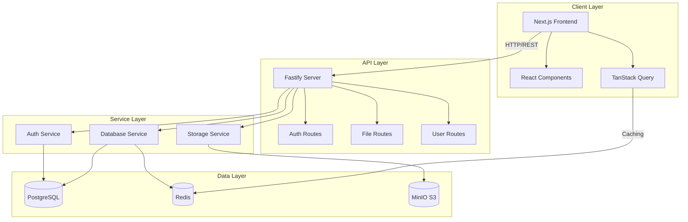

# 🚀 NodeDrive

A modern file storage and sharing platform built with cutting-edge technologies. Upload, store, and share your files with ease! 📁✨

---

## ✨ Features

- 🔐 **Secure Authentication** - Built with better-auth for robust user authentication
- 📤 **File Upload** - Drag & drop or click to upload files effortlessly
- ☁️ **Cloud Storage** - S3-compatible storage with MinIO for scalable file management
- 🎨 **Beautiful UI** - Modern, responsive interface built with Next.js and shadcn/ui
- ⚡ **Fast Performance** - Powered by Bun runtime and Fastify for lightning-fast API responses
- 🗄️ **Reliable Database** - PostgreSQL with Drizzle ORM for efficient data management
- 🔄 **Real-time Updates** - Redis for caching and session management
- 🌙 **Dark Mode** - Built-in theme support for comfortable viewing
- 📱 **Responsive Design** - Works seamlessly on desktop, tablet, and mobile devices

---

## 🛠 Tech Stack

### Frontend

- **Framework**: Next.js 16 (React 19) ⚛️
- **Styling**: Tailwind CSS 4 🎨
- **UI Components**: shadcn/ui, Base UI 🧩
- **State Management**: Zustand, TanStack Query 📊
- **Forms**: TanStack Form 📝
- **Type Safety**: TypeScript 7 📘

### Backend

- **Runtime**: Bun 1.4+ 🥟
- **Framework**: Fastify 5 ⚡
- **Database**: PostgreSQL 🐘
- **ORM**: Drizzle ORM 🗄️
- **Cache**: Redis 🔴
- **Storage**: MinIO (S3-compatible) ☁️
- **Authentication**: better-auth 🔐

### Development Tools

- **Build System**: Turborepo 2 🏗️
- **Package Manager**: Bun 📦
- **Linting**: Biome 🔍
- **Code Quality**: Prettier ✨

---

## 🏗 Architecture



---

## 📋 Requirements

- **Node.js**: >= 24 🟢
- **Bun**: >= 1.4.2 🥟
- **Docker**: For running infrastructure services 🐳
- **Git**: For version control 📌

---

## 🚀 Getting Started

### 1. Clone the Repository

```bash
git clone <your-repo-url>
cd nodedrive
```

### 2. Install Dependencies

```bash
bun install
```

### 3. Start Infrastructure Services

```bash
docker-compose up -d
```

This will start:

- PostgreSQL on port 5432 🐘
- Redis on port 6379 🔴
- MinIO on ports 9000 (API) and 9001 (Console) ☁️

### 4. Set Up Environment Variables

Create a `.env.local` file in `apps/client/`:

```bash
NEXT_PUBLIC_BETTER_AUTH_URL=http://localhost:3001
```

### 5. Run Database Migrations

```bash
cd packages/drizzle
bun run db:push
```

### 6. Start Development Servers

```bash
# Start all services (client + server)
bun run dev

# Or start individually:
# Client (Next.js)
cd apps/client && bun run dev

# Server (Fastify)
cd apps/server && bun run dev
```

### 7. Access the Application

- **Frontend**: http://localhost:3000 🌐
- **Backend API**: http://localhost:3001 🔌
- **MinIO Console**: http://localhost:9001 ☁️

---

## 📁 Project Structure

```
nodedrive/
├── apps/
│   ├── client/              # Next.js frontend application
│   │   ├── src/
│   │   │   ├── app/         # Next.js app router pages
│   │   │   ├── components/  # Reusable UI components
│   │   │   ├── hooks/       # Custom React hooks
│   │   │   └── lib/         # Utility functions
│   │   └── public/          # Static assets
│   │
│   └── server/              # Fastify backend application
│       └── src/
│           ├── config/      # Server configuration
│           ├── lib/         # Utility functions
│           ├── plugins/    # Fastify plugins
│           └── routes/      # API routes
│
├── packages/
│   ├── auth/                # Authentication library (better-auth)
│   ├── drizzle/             # Database ORM (Drizzle)
│   ├── env/                 # Environment configuration
│   ├── eslint-config/       # Shared ESLint configuration
│   ├── storage/             # S3 storage client
│   └── typescript-config/   # Shared TypeScript configuration
│
├── s3_storage/              # MinIO storage directory
├── docker-compose.yml       # Infrastructure services
├── turbo.json              # Turborepo configuration
└── package.json            # Root package configuration
```

---

## 🧪 Available Scripts

### Root Level

```bash
bun run dev          # Start all services in development mode
bun run build        # Build all packages and apps
bun run lint         # Lint all packages and apps
bun run format       # Format code with Prettier
bun run check-types  # Type-check all packages and apps
```

### Database (packages/drizzle)

```bash
bun run db:generate  # Generate database migrations
bun run db:migrate   # Run database migrations
bun run db:push      # Push schema changes to database
bun run db:studio    # Open Drizzle Studio
```

---

## 🔧 Configuration

### Environment Variables

Create a `.env` file in the root directory (optional):

```bash
# Database
POSTGRES_USER=postgres
POSTGRES_PASSWORD=postgres
POSTGRES_DB=postgres

# MinIO/S3
MINIO_ROOT_USER=admin
MINIO_ROOT_PASSWORD=password
S3_BUCKET=nodedrive

# Client URL
CLIENT_URL=http://localhost:3000
```

---

## 🎯 Key Features Explained

### Authentication 🔐

Uses **better-auth** with Drizzle adapter for secure authentication. Supports:

- Email/password authentication
- Session management
- Cookie-based auth

### File Storage ☁️

Built on **MinIO** (S3-compatible) with AWS SDK:

- Secure file uploads
- Presigned URLs for direct access
- Scalable storage solution

### Database 🗄️

**PostgreSQL** with **Drizzle ORM**:

- Type-safe database queries
- Automatic migrations
- Optimized performance

---

## 🐛 Troubleshooting

### Database Connection Issues

```bash
# Check if PostgreSQL is running
docker-compose ps postgres

# Restart services
docker-compose restart
```

### Port Already in Use

Change ports in `docker-compose.yml` or stop conflicting services.

### Build Errors

```bash
# Clear cache and rebuild
rm -rf .next node_modules
bun install
bun run build
```

---

## 📝 License

This project is private and proprietary. All rights reserved. © 2026

---

## 🤝 Contributing

Contributions are welcome! Please follow these steps:

1. Fork the repository
2. Create a feature branch
3. Make your changes
4. Run tests and linting
5. Submit a pull request

---

## 📧 Support

For support, please open an issue in the repository or contact the development team.

---

**Built with ❤️ using modern web technologies**
