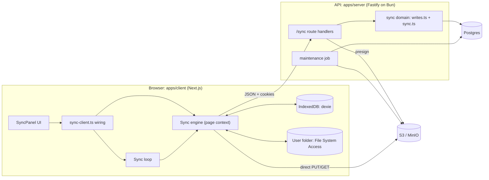
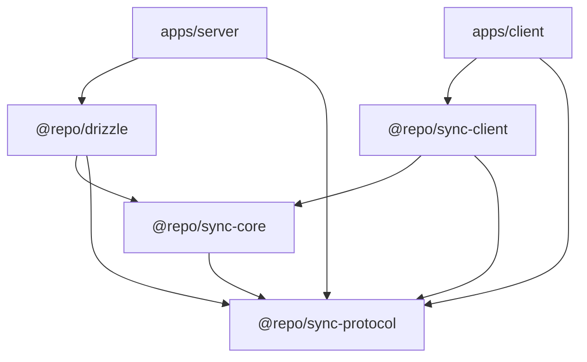
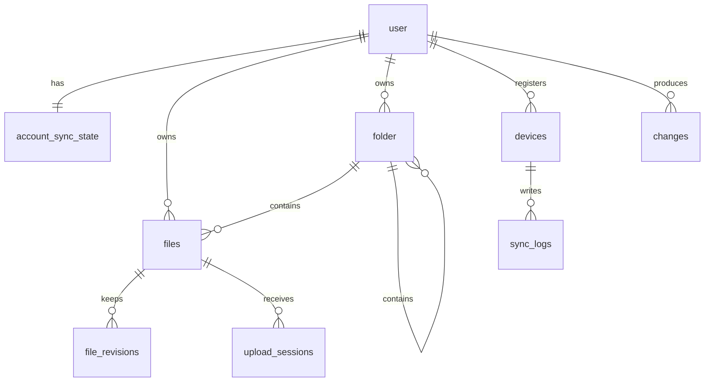
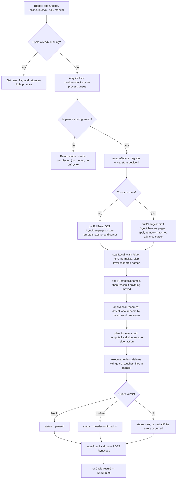
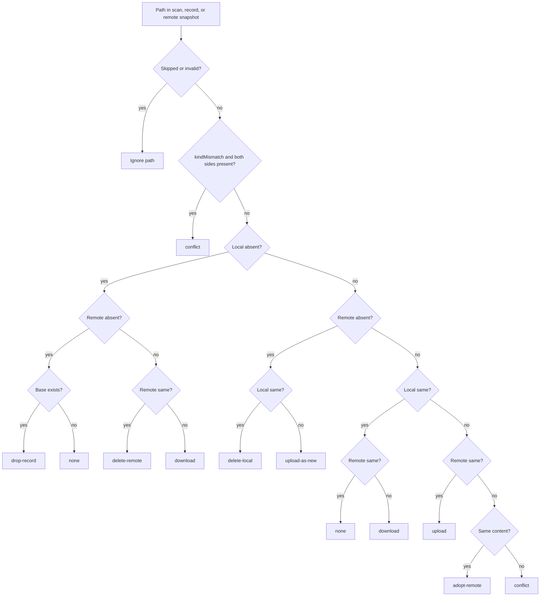
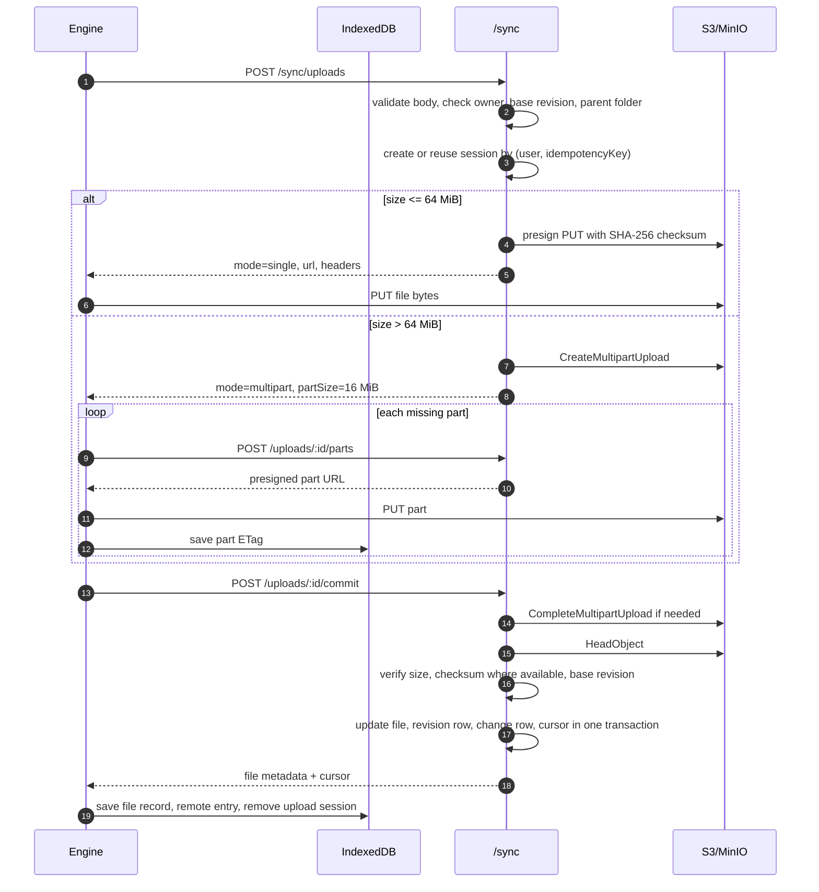
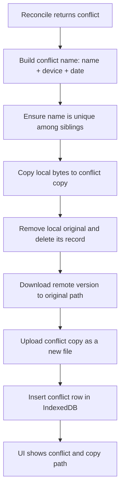
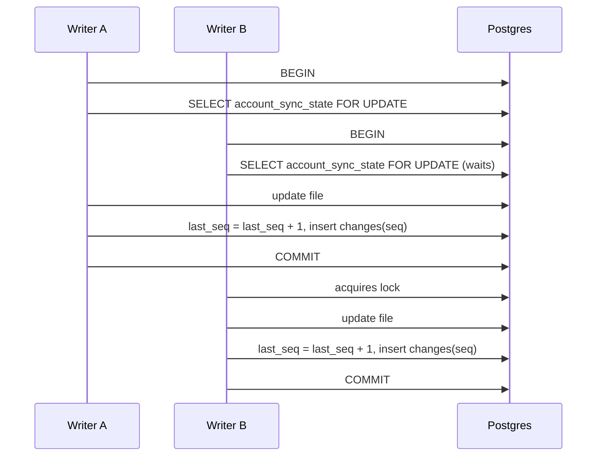
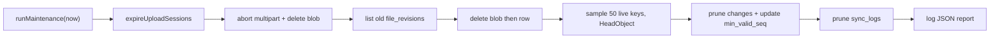

# NodeDrive Sync — Code-Level Explanation

This document explains the sync feature as it is implemented in this repository. The design intent is in `.agents/sync.md`; this file follows the actual code and calls out the places where the implementation differs from the spec.

## 1. What the feature does

A signed-in user picks a local folder in the browser. While the NodeDrive web app is open, a client engine keeps that folder in two-way sync with the user's personal remote files.

- Local changes are found by scanning the folder.
- Remote changes arrive through a change feed with long polling.
- File bytes move directly between the browser and S3/MinIO through presigned URLs. They do not pass through the API server.
- Sync stops when the tab or PWA window closes. There is no background daemon.
- Each cycle that reaches the run stage writes a run log locally and to the server. The permission-denied path returns earlier; see the gaps section.

The implemented scope is **personal files and folders** only. Organization files, shared folders, selective sync, delta transfer and end-to-end encryption are not part of this sync path.

### Main capabilities

| Capability | Implemented by |
|---|---|
| Pick and remember a local folder | `apps/client/src/lib/sync-client.ts`, `packages/sync-client/src/db.ts` |
| Detect local changes | folder scan plus size/mtime check and SHA-256 fallback |
| Receive remote changes | `/sync/changes` plus long poll in `packages/sync-client/src/loop.ts` |
| Full first sync and cursor recovery | `/sync/tree` plus `pullFullTree()` |
| Three-way reconcile | `reconcile()` in `packages/sync-core/src/index.ts` |
| Single and multipart uploads | `/sync/uploads`, S3 presigned URLs, resumable parts |
| Downloads with integrity check | presigned GET plus streaming SHA-256 |
| Rename/move propagation | `applyLocalRenames()` and `applyRemoteRenames()` |
| Conflict copies | `resolveConflict()` and `conflictName()` |
| Delete safety | `guardDeletes()` plus `If-Match` revisions |
| Multi-tab safety | `navigator.locks` |
| History and conflicts UI | `SyncPanel`, `/sync/logs`, IndexedDB `runs`/`conflicts` |
| Retention and cleanup | `runMaintenance()` in `apps/server/src/jobs/maintenance.ts` |

---

## 2. High-level architecture



### Package responsibilities

| Package / app | Responsibility | Important files |
|---|---|---|
| `@repo/sync-protocol` | Shared constants, error codes, types and zod schemas | `packages/sync-protocol/src/index.ts` |
| `@repo/sync-core` | Pure rules: names, paths, reconcile, conflict names, delete guard, backoff | `packages/sync-core/src/index.ts` |
| `@repo/sync-client` | Browser engine, IndexedDB, filesystem adapters, transfers, long-poll loop | `packages/sync-client/src/*` |
| `@repo/drizzle` | Sync tables, change log writes, upload-session commit, queries, pruning | `packages/drizzle/src/db/sync.ts`, `writes.ts`, `models/SyncTables.ts` |
| `apps/server` | Fastify route handlers, presigning helpers, maintenance job | `apps/server/src/routes/syncRoute.ts`, `sync/uploads.ts`, `jobs/maintenance.ts` |
| `apps/client` | Sync UI, browser wiring, PWA manifest and service worker | `components/sync/sync-panel.tsx`, `lib/sync-client.ts`, `public/sw.js` |
| `@repo/storage` | S3 client, presigned URLs, multipart operations, object metadata | `packages/storage/src/index.ts` |

Dependency direction:



`sync-core` is pure and I/O-free, so both browser and server can use the same name, conflict and guard rules.

---

## 3. Server data model

The implementation uses the existing `files` and `folder` tables plus sync-specific tables. There is no unified `files.path_key` table as described in the spec. Files and folders are separate tables. Name collisions are checked in application code under an account-level write lock.



### Sync tables

| Table | Key fields | Purpose |
|---|---|---|
| `account_sync_state` | `account_id` PK, `last_seq`, `min_valid_seq` | Per-account cursor counter and oldest readable seq |
| `changes` | `(account_id, seq)` PK, `node_id`, `node_kind`, `op`, `revision`, `payload`, `created_at` | Append-only change feed |
| `upload_sessions` | id, `user_id`, `file_id`, `parent_id`, `name`, `expected_size`, `expected_hash`, `part_size`, `multipart_upload_id`, `status`, `idempotency_key`, `expires_at`, `result_*` | Upload lifecycle and idempotent commit |
| `devices` | id, `user_id`, `label`, `user_agent`, `last_seen_at` | Device registry for conflict names and logs |
| `sync_logs` | id, `user_id`, `device_id`, `run_id`, counts, bytes, status, error summary | Server-side sync history |
| `file_revisions` | id, `file_id`, `revision`, `storage_key`, `size`, `content_hash` | Previous blob versions for recovery |

### Existing file/folder columns used by sync

`files`: `folder_id`, `original_name`, `size`, `content_hash`, `revision`, `mtime`, `isDeleted`, `deleted_at`, `storage_url`.

`folder`: `parent_id`, `name`, `revision`, `isDeleted`, `deleted_at`.

Deletes are soft deletes (`isDeleted = true`). The sync API's delete marks a file as trashed, so server-side recovery remains possible. There is no OS trash integration.

### Client IndexedDB model

Defined in `packages/sync-client/src/db.ts`.

| Store | Key | Contents |
|---|---|---|
| `meta` | `key` | `deviceId`, `cursor` |
| `files` | relative path | `remoteId`, kind, base revision/hash, local size/mtime/hash |
| `remote` | remote id | Cached `TreeEntry` snapshot of the remote tree |
| `uploads` | relative path | Resumable multipart session and completed part ETags |
| `runs` | run id | Local copy of each sync run |
| `handles` | id | Persisted `FileSystemDirectoryHandle` under id `root` |
| `conflicts` | auto id | Original path, copy path, detection time, resolved flag |

Important design choice: the engine keeps a **complete cached remote snapshot** (`remote` store), not only a delta. It plans against that snapshot. This makes crash recovery simple: after a crash, the next cycle replans from the persisted snapshot and local scan.

---

## 4. One sync cycle

Entry point: `createSyncEngine().cycle()` in `packages/sync-client/src/engine.ts`.



The cycle is always **pull before push**. Remote changes are applied to the cached snapshot first, then the combined local/remote state is reconciled.

### Cycle result

`CycleStatus` values:

- `ok`
- `partial` — some per-file actions failed, others continued
- `needs-permission` — stored folder handle exists but permission is not granted
- `paused` — delete guard blocked an empty/unreadable root
- `needs-confirmation` — delete guard wants explicit user approval
- `error` — cycle-level failure

Counts: `uploaded`, `downloaded`, `deleted`, `moved`, `adopted`, `conflicts`, `errors`, `bytesUp`, `bytesDown`.

---

## 5. Client startup and permission flow

Wiring is in `apps/client/src/lib/sync-client.ts`.

1. `isSyncSupported()` checks `showDirectoryPicker` and `indexedDB`.
2. `chooseFolder()` calls `showDirectoryPicker({ mode: "readwrite" })` and persists the handle in IndexedDB.
3. `savedFolder()` loads the handle on the next app open.
4. On startup, the engine calls `fs.permission()`. If the browser has dropped permission, the cycle returns `needs-permission`.
5. `resumeSync()` must be called from a user click because browsers only show the permission prompt inside a user gesture.
6. `navigator.storage.persist()` is requested to reduce IndexedDB eviction risk.

The UI state machine (view level) is separate from `CycleStatus`:

- `checking` — probing support and loading a saved handle
- `unsupported` — no directory picker or IndexedDB
- `no-folder` — user has not picked a folder
- `ready` — folder known, sync may run

`SyncPanel` displays permission, delete-confirmation, conflict and history cards.

---

## 6. Change feed and long polling

### Server side

`GET /sync/changes?cursor=N&limit=500&wait=25&deviceId=...` is handled in `apps/server/src/routes/syncRoute.ts`.

1. Validate query with `changesQuery`.
2. Reject a second held poll for the same `account:device` with `429 rate_limited`.
3. `readPage()` checks `cursor < min_valid_seq`. If true, return `410 cursor_expired`.
4. Otherwise query `changes` where `seq > cursor`, ordered by `seq`, limit + 1 to detect `hasMore`.
5. If `wait > 0` and no rows, hold the request and re-check every second until rows appear, the deadline passes, or the client disconnects.
6. Return `{ changes, nextCursor, hasMore }`. `nextCursor` is the last seq, or the supplied cursor when empty.

The held poll registry is an in-process `Set`. This is correct for one server instance. Multiple instances would need Redis or Postgres `LISTEN/NOTIFY`; the code marks this as a later optimization.

```mermaid
sequenceDiagram
  autonumber
  participant Loop as Sync loop
  participant Engine as Engine
  participant API as Fastify /sync
  participant PG as Postgres

  Loop->>Engine: hasRemoteChanges(signal, 25)
  Engine->>API: GET /sync/changes?cursor=...&limit=1&wait=25&deviceId=...
  API->>PG: check min_valid_seq and changes
  alt change exists
    PG-->>API: rows
    API-->>Engine: changes, nextCursor
  else no change yet
    loop every 1 second until deadline
      API->>PG: re-check changes
    end
    API-->>Engine: empty page with same cursor
  end
  Engine-->>Loop: true or false
  alt true
    Loop->>Engine: cycle("poll")
  else error
    Loop->>Loop: backoff 1s to 30s with jitter
  end
```

### Client side

`createSyncLoop()` in `packages/sync-client/src/loop.ts`:

- Calls `start()` on app startup.
- Starts an interval trigger every 30 seconds.
- Starts an immediate `open` cycle.
- Runs a long-poll loop with `pollWaitSeconds = 25`.
- Aborts the held request at a 35 second hard timeout.
- Re-polls immediately after a response.
- Backs off exponentially with jitter on errors.
- Coalesces triggers that arrive during a cycle into one rerun.
- Wires `focus`, `online` and `visibilitychange` in `apps/client/src/lib/sync-client.ts`.

`hasRemoteChanges()` also treats `410 cursor_expired` as "changes exist" so the next cycle performs a full tree reset.

---

## 7. First sync and full-tree recovery

`pullFullTree()` in `engine.ts`:

1. `GET /sync/tree` with a page token until `nextPageToken` is null.
2. `/sync/tree` pages the live personal `files` and `folder` rows by id using a base64 token `{ cursor, after }`.
3. The first page reads `currentCursor(account)`.
4. All entries are stored in the IndexedDB `remote` store in one transaction, and `meta.cursor` is set to the returned cursor.

Then the normal scan and reconcile run.

Spec difference: the spec says "store cursor only after the initial reconcile completes". The implementation stores the cursor during `pullFullTree` but persists the full remote snapshot in the same step. If the tab crashes before local actions finish, the next cycle still replans from that snapshot. It does not replay the delta; it recomputes against the cached tree. This is safe for convergence but is a different recovery model.

`pullChanges()` uses the same logic when `/sync/changes` returns `410`.

---

## 8. Local scan and change detection

`scanLocal()` and `localState()` in `engine.ts`.

1. `fs.list()` recursively walks the folder.
2. Every path is NFC-normalized.
3. A path is skipped when any segment matches:
   - `IGNORED_NAME`: `.crdownload`, `.tmp`, `.part`, `~$...`, `.DS_Store`, `Thumbs.db`
   - `checkName()` failure: empty, illegal characters, Windows reserved names, over 255 bytes, trailing dot or space
4. Case-insensitive duplicates within the scan are skipped after the first occurrence.
5. `isSkipped()` also skips descendants of a skipped folder.

For each path, `localState()` decides the local side:

- No local entry → `absent`
- No record, or kind differs → `changed`
- Folder present → `same`
- File size and mtime match the stored record → `same` (uses stored hash)
- Otherwise hash the file and compare with `baseHash`:
  - equal → `same`
  - different → `changed`

Hashing uses `hash-wasm` (`createSHA256`) and streams chunks from the Blob. This avoids loading a large file into memory as a single buffer.

Trade-off: a file with the same size and same mtime is assumed unchanged even if its bytes changed. This is the standard scanner shortcut; it avoids hashing every file on every cycle.

`remoteState()` compares the cached remote node with the local record:

- no remote node → `absent`
- no record → `changed`
- `remoteId`, `baseRevision` and kind all match → `same`
- otherwise → `changed`

---

## 9. Reconcile decision engine

`reconcile()` in `packages/sync-core/src/index.ts` is pure. Inputs: `base`, `local`, `remote`, `sameContent`, `kindMismatch`.



### Action meanings in `runAction()`

| Action | Effect |
|---|---|
| `none` | Nothing; possibly a `touch` record update if only mtime/size changed |
| `drop-record` | Delete the local sync record; both sides already absent |
| `download` | Create folder or stream remote file to local path |
| `upload` | Upload local file or create remote folder using the existing record |
| `upload-as-new` | Upload local content as a new remote file; used when remote was deleted |
| `delete-local` | Remove the local file/folder and its record |
| `delete-remote` | DELETE the remote file with `If-Match`, then drop the record |
| `adopt-remote` | Both sides changed but hashes match; adopt remote revision without transfer |
| `conflict` | Keep both versions; see conflict flow |

`touch` is not a reconcile action. It is added by `plan()` when the content hash is unchanged but local size/mtime changed, so the record absorbs the new metadata and does not upload again.

### Decision table as implemented

| Local | Remote | Result |
|---|---|---|
| same | same | none |
| same | changed | download |
| changed | same | upload |
| changed | changed, same hash | adopt remote revision |
| changed | changed, different hash | conflict |
| same | absent | delete local |
| absent | same | delete remote |
| changed | absent | upload as new |
| absent | changed | download |
| absent | absent, base exists | drop record |
| absent | absent, no base | none |
| new | new, same path, same hash | adopt remote |
| new | new, same path, different hash | conflict |
| both present, kind differs | any | conflict |

---

## 10. Upload path

`pushFile()` in `engine.ts` builds an `UploadBody`, creates a session, transfers bytes, commits, then updates IndexedDB.

### Single upload

- File size at or below `MULTIPART_THRESHOLD_BYTES` (64 MiB).
- Server presigns one PUT with `x-amz-checksum-sha256`.
- Browser PUTs the Blob directly to storage.
- Commit runs `HeadObject` and compares size and checksum for single-part sessions.

### Multipart upload

- File above 64 MiB.
- Part size is `PART_SIZE_BYTES` (16 MiB).
- Server creates an S3 multipart upload and stores its upload id on the session.
- Client requests presigned part URLs for missing parts only.
- Completed `{ partNumber, etag }` values are saved in IndexedDB after each part.
- On retry, existing parts are skipped and only missing parts are requested and uploaded again.
- Commit sends the ordered part list; server calls `CompleteMultipartUpload`, then checks stored size.



### Upload session rules

- Session TTL: 24 hours.
- Max file size: 5 GiB, enforced by the zod schema.
- `idempotencyKey` is unique per user; repeating create returns the existing session.
- Client key is a SHA-256 of `deviceId|path|hash|remoteId|baseRevision`.
- New files send `parentId`; updates send `fileId` and `baseRevision`, and the pair is required together.
- Create-time base revision mismatch returns `409 revision_conflict`.
- Commit re-checks `session.base_revision` against the current file revision.
- Commit is idempotent: a committed session returns its stored `result_file_id` and `result_seq`.
- If commit fails after bytes were stored, the route deletes the stored object when the session was open and the error is not `session-closed`.

### Integrity limits

- Single upload: S3 validates `x-amz-checksum-sha256`; server verifies the stored checksum at commit.
- Multipart upload: server verifies size and part count/order, but **does not verify a full-object SHA-256**; S3 does not expose a simple full-object SHA-256 for multipart uploads. The code marks this as a future improvement.
- Downloads always verify the expected hash while streaming.

---

## 11. Download path

`downloadNode()` in `engine.ts`.

1. For a folder: `fs.mkdir(path)`, then store a folder record with the remote revision.
2. For a file: request a presigned URL from `POST /sync/download-urls`. The current engine requests one file at a time, not in a batch.
3. Fetch the URL.
4. Open a write sink on the local path.
5. Read the response stream, update a streaming SHA-256, and write each chunk.
6. If the expected hash is present and does not match, throw before closing the sink.
7. On error, abort the sink. The retry wrapper tries up to 3 times for retryable failures.
8. On success, close the sink, stat the result, and store `baseRevision`, `baseHash`, `localSize`, `localMtime`, `localHash`.
9. Count bytes and downloaded files.

Presigned download TTL is 300 seconds; upload part TTL defaults to 900 seconds.

---

## 12. Rename and move detection

Both helpers only handle **files**, not folders.

### Remote rename or move

`applyRemoteRenames()`:

1. Build a map `remoteId -> current remote path`.
2. For every local record, find the node's new path.
3. Skip if the path did not change, the node is not a file, the hash is missing, the base hash differs, or the target path is already present.
4. If the old local path still exists, physically move the file by copying and removing.
5. Update the record path and base revision in one IndexedDB transaction.
6. Count a move.

This avoids re-downloading an unchanged file after a remote rename.

### Local rename or move

`applyLocalRenames()`:

1. Find records that disappeared locally while the remote node still has the same id and revision.
2. Find fresh local files that are not known records and not present remotely.
3. Hash the fresh files.
4. Match a disappeared record to a fresh file by `baseHash`.
5. Send one `POST /sync/files/:id/move` with `If-Match` instead of delete plus upload.
6. On success, replace the old record with the new path and update the remote snapshot.
7. On `409`, skip; the normal reconcile handles it.

This makes a local rename cost one API call and zero bytes.

---

## 13. Deletes and delete safety

### Delete flow

A local delete is detected as `local = absent`, `remote = same` → `delete-remote`.

`runAction("delete-remote")`:

1. Requires a remote file node and a local record.
2. Calls `DELETE /sync/files/{id}` with `If-Match: revision`.
3. Server marks `isDeleted = true`, increments the revision, writes a `delete` change, and returns the new cursor.
4. Client removes the local record and cached remote node.

A remote delete is detected as `remote = absent`, `local = same` → `delete-local`, which removes the local file and record.

Remote folder deletes are not applied by `runAction`; `delete-remote` returns early for a non-file. Folder deletion is therefore a gap.

### Mass-delete guard

`guardDeletes({ deletes, known, scanned })`:

- `deletes === 0` → `ok`
- `scanned === 0` → `block` (possible unmounted or unreadable root)
- `deletes > max(known * 0.2, 50)` → `confirm`
- otherwise → `ok`

`execute()` applies the guard once per cycle:

- `block` → status `paused`
- `confirm` → status `needs-confirmation`
- `ok` → deletes run

`engine.confirmDeletes()` sets a one-cycle flag. The UI's "Allow these deletes" button calls it, then triggers a new cycle. The flag is cleared after the next guard evaluation.

Deletes are applied deepest-first so children are removed before parents.

---

## 14. Conflict handling

`resolveConflict()` implements "keep both versions":



Details:

- The remote version wins the original path.
- The local version is preserved as a conflict copy.
- `conflictName()` uses `stem + " (conflicted copy <device> <date>)" + ext`, trims the stem to fit 255 bytes, and sanitizes illegal characters in the device label.
- `uniqueName()` adds ` (2)`, ` (3)`, ... on case-insensitive collisions.
- A conflict row is stored with `resolved = false`; the UI can mark it resolved.
- Only file-vs-file conflicts are supported. Folder conflicts throw `"Folder conflicts need manual resolution"`, which becomes a per-action error and leaves the cycle `partial`.

The conflict copy is uploaded as a new file with the same content as the local version. The original remote file is not overwritten.

---

## 15. Echo suppression and metadata bookkeeping

Without echo suppression, writing a downloaded file would look like a new local change on the next scan.

The engine handles this by storing the result metadata immediately after every local write:

- After download: `localSize`, `localMtime`, `localHash`, `baseRevision`, `baseHash`.
- After upload: same fields from the uploaded file.
- After conflict copy: copied file is uploaded and recorded.
- After remote delete: the local record is removed, so the missing file is not treated as a new local delete.
- After a rename: the record moves to the new path with the new base revision.
- `touch`: if content is unchanged but size/mtime changed, only the record metadata is updated.

This is per-client and relies on IndexedDB persistence. If IndexedDB is evicted, the next run performs a full tree sync.

---

## 16. Cursor correctness

This is the most important server invariant.

`lockAccount()` in `packages/drizzle/src/db/writes.ts`:

1. `INSERT ... ON CONFLICT DO NOTHING` ensures the account row exists.
2. `SELECT ... FOR UPDATE` serializes writers for that account.

Every mutation runs in one transaction:

1. Lock the account row.
2. Perform the file/folder write.
3. Increment `account_sync_state.last_seq` and insert the `changes` row via `recordChange()`.
4. Commit.

Because the increment and change insert happen in the same transaction as the data write, committed seq values are gapless and ordered. A timestamp cursor or global sequence could skip changes under concurrent commits; the per-account counter avoids that.



Client cursor rule:

- `applyChanges()` writes the remote snapshot and the new cursor in one IndexedDB transaction.
- `pullChanges()` advances page by page until `hasMore` is false.
- The next cycle plans against the persisted remote snapshot, so a crash after cursor advance still converges.

---

## 17. Scheduling and multi-tab safety

`createSyncLoop()`:

- `start()` runs one `open` cycle, starts an interval timer, and starts the long-poll loop.
- `request(trigger)` is single-flight:
  - if a cycle is running, it stores the trigger as `rerun` and returns the in-flight promise;
  - after the current cycle, it runs one more cycle for the latest rerun trigger.
- `stop()` stops the timer and aborts the held poll.
- Triggers: `open`, `focus`, `online`, `interval`, `poll`, `manual`.

Cross-tab safety:

- In the browser, `navigatorLock("nodedrive-sync")` uses `navigator.locks.request`.
- In tests or environments without the Lock API, the engine falls back to an in-process promise queue.
- This prevents two tabs from syncing the same IndexedDB state at the same time.

The loop does not run in a service worker.

---

## 18. Logging and UI

For a normal cycle:

1. Creates a `runId` with `crypto.randomUUID()`.
2. Collects counts and per-file errors.
3. Saves a local `runs` row with status, counts and error summary.
4. Sends `POST /sync/logs` with trigger, start/end times, status, counts, bytes and first error summary.
5. Calls `options.onCycle(result)` so the UI updates immediately.

Important exception: `cycleUnlocked()` returns `needs-permission` before this run stage. That path writes no local run, posts no server log, and does not call `onCycle`. See the gaps section.

Server logging:

- `insertRunLog()` is idempotent on `(user_id, run_id)`.
- `GET /sync/logs` pages newest-first using the last `created_at` as the token.
- UI loads the latest 10 runs in `SyncPanel`.
- Conflicts are read from IndexedDB, not the server.

The UI shows:

- current status and last cycle result
- "Resume sync" when permission is missing
- "Allow these deletes" when the guard needs confirmation
- "Sync now" and "Choose another folder"
- unresolved conflicts and their copy paths
- recent run summaries

---

## 19. Maintenance job

`apps/server/src/jobs/maintenance.ts` runs one idempotent pass:

1. Mark expired open upload sessions as `expired`.
2. Abort their multipart uploads and delete stored objects.
3. Delete `file_revisions` older than 90 days, in batches of 500, and delete their blobs.
4. Spot-check 50 random live storage keys with `HeadObject`.
5. Prune change-log rows older than 90 days and advance `min_valid_seq`.
6. Prune `sync_logs` older than 30 days.
7. Print a JSON report line.

Run it with:

```bash
bun run --cwd apps/server jobs:maintenance
```

It is a scheduled-job script, not an in-process timer. The deployment platform must schedule it.



---

## 20. PWA behavior

- `apps/client/src/app/manifest.ts` provides name, icons, standalone display, start URL and scope.
- `apps/client/src/components/pwa/service-worker-register.tsx` registers `/sw.js`.
- `apps/client/public/sw.js` caches only same-origin GETs matching `/_next/static/` or `/icons/`.
- It does not cache navigation HTML, API responses or presigned URLs.
- All sync logic stays in the page context.
- The UI feature-detects directory access and shows an unsupported-browser card on Firefox, Safari and mobile.

This makes the app installable and gives static-asset caching. It is not an offline-first app shell.

---

## 21. Security and limits

- The Fastify `authGuard` plugin resolves the session before routes run. Every `/sync` handler checks `request.user.id` again.
- Every query is scoped by the current user. Personal sync excludes rows with a non-null `organization_id`.
- Presigned URLs are short-lived and scoped to one object and method.
- Single upload presign includes a SHA-256 checksum condition.
- Bucket CORS exposes `ETag` for multipart commits and allows only the app origin, configured by `jobs/apply-cors.ts`.
- Object keys are namespaced by user: `users/<userId>/...`.
- The whole sync route has a Redis fixed-window limit of 600 requests per minute per account.
- Long polling is capped at one held request per device per process.
- File contents and full presigned URLs are not logged.

Defined but not currently emitted by routes: `too_large`, `quota_exceeded`, `forbidden`. Oversized bodies fail schema validation as `invalid_request` rather than `413`. There is no quota service in the sync path.

---

## 22. API surface

Prefix: `/sync` on the Fastify server. The client uses `NEXT_PUBLIC_BETTER_AUTH_URL` as the base URL and sends cookies.

| Method and path | Purpose | Important behavior |
|---|---|---|
| `POST /sync/devices` | Register or refresh a device | Returns `deviceId`; updates `last_seen_at` |
| `GET /sync/tree` | Full snapshot, paginated | Keyset paging by id; token contains cursor and last id |
| `GET /sync/changes` | Delta feed and long poll | `cursor`, `limit`, `wait`, `deviceId`; `410` on expired cursor |
| `POST /sync/download-urls` | Presigned GET URLs | One URL per owned live file; 300 s TTL |
| `POST /sync/uploads` | Create upload session | Single or multipart; idempotent; base revision check |
| `POST /sync/uploads/:id/parts` | Presign part URLs | Rejects non-open or non-multipart sessions |
| `POST /sync/uploads/:id/commit` | Finalize upload | Checks size/hash where possible and base revision; idempotent |
| `POST /sync/uploads/:id/abort` | Cancel upload | Aborts S3 multipart and marks session aborted |
| `POST /sync/folders` | Create folder | Rejects name collisions for sync |
| `POST /sync/files/:id/move` | Move or rename | Requires `If-Match`; increments revision; writes `move` change |
| `DELETE /sync/files/:id` | Soft-delete file | Requires `If-Match`; marks trashed; writes `delete` change |
| `POST /sync/logs` | Submit run log | Idempotent per `(user, runId)` |
| `GET /sync/logs` | List run history | Newest first, 50 per page |

Error envelope: `{ code, message }`.

| Status | Code | When |
|---|---|---|
| 400 | `invalid_request` | Schema/path validation failure |
| 401 | `unauthorized` | No authenticated user |
| 404 | `not_found` | Missing file, folder or session |
| 409 | `revision_conflict` | `If-Match` or base revision mismatch |
| 409 | `name_collision` | Case-insensitive sibling collision |
| 410 | `cursor_expired` | Cursor below `min_valid_seq` |
| 422 | `integrity_failed` | Size/checksum mismatch at commit |
| 429 | `rate_limited` | Route rate limit or duplicate held poll |

One inconsistency: an expired session is mapped to `410` with code `not_found`, not a dedicated session error.

---

## 23. Important functions

### `@repo/sync-core`

| Function | File | Role |
|---|---|---|
| `checkName()` | `src/index.ts` | NFC normalize and validate one path segment |
| `pathKey()` | `src/index.ts` | Case-insensitive collision key |
| `splitName()` / `uniqueName()` | `src/index.ts` | Extension split and free-name search |
| `reconcile()` | `src/index.ts` | Pure three-way decision table |
| `conflictName()` | `src/index.ts` | Conflict copy name within byte limit |
| `guardDeletes()` | `src/index.ts` | Empty-root and mass-delete guard |
| `backoffMs()` | `src/index.ts` | Jittered retry delay, 1 s to 30 s |

### `@repo/sync-client`

| Function | File | Role |
|---|---|---|
| `createSyncEngine()` | `engine.ts` | Main engine and closure state |
| `cycle()` | `engine.ts` | One locked sync cycle |
| `pullFullTree()` / `pullChanges()` | `engine.ts` | Fetch and persist remote state |
| `applyChanges()` | `engine.ts` | Apply change page to cached remote tree and cursor |
| `scanLocal()` | `engine.ts` | Recursive folder scan with validation |
| `localState()` / `remoteState()` | `engine.ts` | Compute changed/same/absent sides |
| `plan()` | `engine.ts` | Run reconcile for every path |
| `execute()` | `engine.ts` | Order actions and enforce delete guard |
| `runAction()` | `engine.ts` | Apply one action |
| `pushFile()` / `pushFolder()` | `engine.ts` | Upload and create remote nodes |
| `uploadParts()` | `engine.ts` | Resumable multipart upload |
| `downloadNode()` | `engine.ts` | Streamed download with hash verification |
| `applyRemoteRenames()` / `applyLocalRenames()` | `engine.ts` | Move detection |
| `resolveConflict()` | `engine.ts` | Preserve both versions |
| `attempt()` | `engine.ts` | Three-attempt retry for retryable failures |
| `hasRemoteChanges()` | `engine.ts` | Long-poll probe |
| `createSyncLoop()` | `loop.ts` | Triggers, single-flight, poll loop, backoff |
| `createSyncDb()` | `db.ts` | Dexie schema and stores |
| `createSyncApi()` | `api.ts` | Typed `/sync` client and `SyncApiError` |
| `createAccessFs()` | `fs-access.ts` | Production File System Access adapter |
| `createMemoryFs()` | `fs-memory.ts` | In-memory test adapter |

### Server and data layer

| Function | File | Role |
|---|---|---|
| `syncRoute()` | `apps/server/src/routes/syncRoute.ts` | Registers all `/sync` endpoints |
| `finalizeStoredUpload()` | `apps/server/src/sync/uploads.ts` | Complete multipart, verify size/checksum |
| `presignSingleUpload()` | `apps/server/src/sync/uploads.ts` | Single PUT with SHA-256 condition |
| `lockAccount()` | `db/writes.ts` | Serialize writers per account |
| `recordChange()` | `db/writes.ts` | Increment cursor and insert change |
| `commitUploadSession()` | `db/writes.ts` | Atomic publish or idempotent replay |
| `createUploadSession()` | `db/sync.ts` | Idempotent session creation |
| `moveFileToFolder()` | `db/writes.ts` | Revision-checked move/rename |
| `updateFileForUser()` | `db/writes.ts` | Trash/restore and delete/create change |
| `createFolder()` | `db/writes.ts` | Folder creation with collision policy |
| `listChangesSince()` | `db/sync.ts` | Delta query |
| `listSyncTree()` | `db/sync.ts` | Paged full tree |
| `currentCursor()` / `minValidSeq()` | `db/sync.ts` | Cursor reads |
| `pruneChanges*()` | `db/sync.ts` | Retention and `min_valid_seq` update |
| `runMaintenance()` | `apps/server/src/jobs/maintenance.ts` | Expiry, retention and spot checks |

---

## 24. Tests and invariants

| Test file | What it covers |
|---|---|
| `packages/sync-core/src/index.test.ts` | Every reconcile row, name rules, conflict names, delete guard, backoff |
| `packages/drizzle/src/db/sync.test.ts` | Concurrent writes get gapless ordered seq, name suffixes, trash/restore changes, tree paging |
| `apps/server/src/routes/syncRoute.test.ts` | Folder/create/upload/commit replay/tree/changes/download, stale revision, integrity failure |
| `apps/server/src/sync/client.test.ts` | Two-device convergence, edit/delete propagation, conflicts, multipart resume, rename, 410 reset, long-poll push, cross-tab lock, delete guard |

Run:

```bash
bun test
```

The server tests refuse to run unless the database ends in `/nodedrive_test` and the bucket ends in `-test`.

Mandatory invariants exercised by the code and tests:

- No change is skipped or applied twice with different results.
- A crash leaves enough persisted state to recover by rerunning.
- No delete happens without the guard and a matching revision.
- Two devices editing the same file end with both versions preserved.
- Cursor allocation is gapless under concurrent writes.
- Commit replay returns the original result.

---

## 25. Gaps and deviations from `.agents/sync.md`

These are real differences between the draft spec and the current code. They matter for planning.

| Area | Spec | Current code | Impact |
|---|---|---|---|
| API host | Next.js route handlers under `/api/sync` | Fastify routes under `/sync` | Client calls the Fastify server directly |
| Package split | `sync-server` package | Domain logic lives in `@repo/drizzle` and `apps/server` | No `sync-server` package boundary |
| Server model | One `files` table with `path_key` and partial unique index | Separate `files` and `folder` tables; app-level name checks under account lock | Name uniqueness is not enforced by a DB constraint |
| Tombstones | 90-day tombstone retention | Soft-deleted rows stay in `files`/`folder`; only change log, revisions and logs are pruned | Tombstone rows grow indefinitely |
| Client state | `pendingOps`, state enum, upload sessions, meta fields | `files`, `remote`, `uploads`, `runs`, `handles`, `conflicts`; meta only deviceId/cursor | No durable retry queue; stale upload records can remain |
| Half-written files | Require stable size/mtime across two checks | No debounce | A file being written can be uploaded mid-write |
| Multipart parallelism | Bounded parallel parts | Parts upload sequentially; only files run in parallel (default 3) | Large uploads are slower |
| Multipart hash | Verify size and hash | Size and part order only; no full-object SHA-256 | Weaker integrity for multipart uploads |
| Download batching | Batch presigned URLs | One URL request per file | More API calls for many files |
| Folder move/delete | Apply remote folder moves and deletes | Rename/move helpers only handle files; a moved remote folder falls back to local delete plus re-download; remote folder delete is skipped | Folder restructuring is expensive and can trip the delete guard |
| Folder conflicts | Conflict flow | File-only; folder conflicts throw and become per-file errors | Manual intervention needed |
| Server name validation | Validate every path/name server-side | Zod checks trim and length; full `checkName()` is not called | Illegal or reserved remote names can enter the DB |
| Rate limits | Per account and per device | 600/min per account; one held poll per device | No general per-device quota |
| Quotas / max size | `413 too_large`, `507 quota_exceeded` | Schema max size returns `invalid_request`; no quota service | Different error contract |
| Long poll backend | Optional LISTEN/NOTIFY for multiple instances | In-process held-poll registry and 1 s DB polling | Multi-instance long poll is not coordinated |
| Background jobs | Scheduled expiry and pruning | `jobs:maintenance` script | Requires external scheduler |
| PWA offline shell | Precache app shell | Service worker caches only `_next/static/` and icons | App is installable, not fully offline |
| Organisation sync | Not defined as personal-only | Sync queries exclude `organization_id` | Shared/org files do not sync |
| Metrics/alerts | Metrics and alerts | Structured logs and a JSON maintenance line | No dashboard or alerting |
| Upload abort | Client can abort | Server endpoint exists; client engine never calls it | Failed sessions rely on TTL expiry |
| Permission status delivery | Visible `needs-permission` state and resume button | `needs-permission` returns before `saveRun` and `onCycle` | `SyncPanel` may keep the previous status and not show the resume button until another cycle callback fires |

### Minor correctness notes

- `pullFullTree()` persists the cursor before the initial local reconcile. Recovery relies on the persisted remote snapshot, not on replaying the delta.
- `localState()` trusts size+mtime for unchanged files and does not rehash them. A content change that preserves both values is missed.
- `resolveConflict()` throws on folder conflicts, so a folder/file kind mismatch repeats as a `partial` error until the user resolves it.
- `needs-permission` is returned before `saveRun()` and `options.onCycle()`, so it is not logged and may not reach `SyncPanel`. This weakens the spec's required visible "Resume sync" state on the first load after permission loss.
- The sync delete route marks files trashed rather than hard-deleting them. The UI copy says deletes go to the server bin, not the OS trash.
- The server route maps an expired upload session to `410` with code `not_found`, not a dedicated session code.
- The multipart resume store is keyed by path. Changing a file's path during a failed multipart upload loses the resumable parts; a new session is created.
- `syncRoute` checks `session.status === "open"` before finalizing. A replay of a committed session skips storage finalization and returns the stored result, which is the intended idempotency path.

---

## 26. Quick file map

```text
packages/
  sync-protocol/src/index.ts       constants, zod schemas, shared types
  sync-core/src/index.ts          pure reconcile/name/guard/backoff rules
  sync-client/src/
    engine.ts                     scan, plan, transfer, conflict, cursor logic
    loop.ts                       triggers, single-flight, long poll, backoff
    db.ts                         Dexie IndexedDB schema
    api.ts                        typed /sync HTTP client
    fs.ts                         filesystem port
    fs-access.ts                  File System Access adapter
    fs-memory.ts                  in-memory test adapter
  drizzle/src/
    models/SyncTables.ts          sync table definitions
    db/writes.ts                  cursor lock, writes, upload commit
    db/sync.ts                    queries, devices, logs, pruning
apps/server/src/
  routes/syncRoute.ts             all /sync endpoints
  sync/uploads.ts                 presign and multipart finalize helpers
  jobs/maintenance.ts             expiry, retention, spot checks
apps/client/src/
  lib/sync-client.ts              browser wiring and lifecycle
  components/sync/sync-panel.tsx  status, conflicts, history UI
  public/sw.js                    app-shell static cache
```
